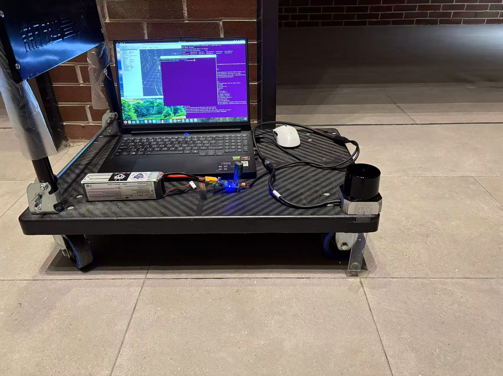
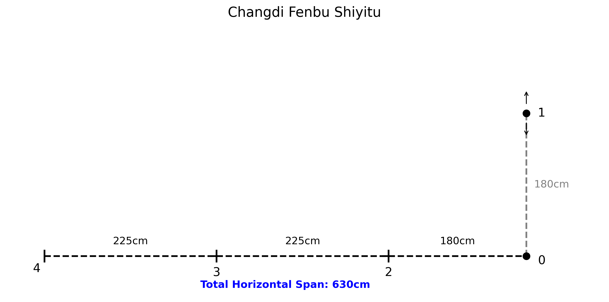
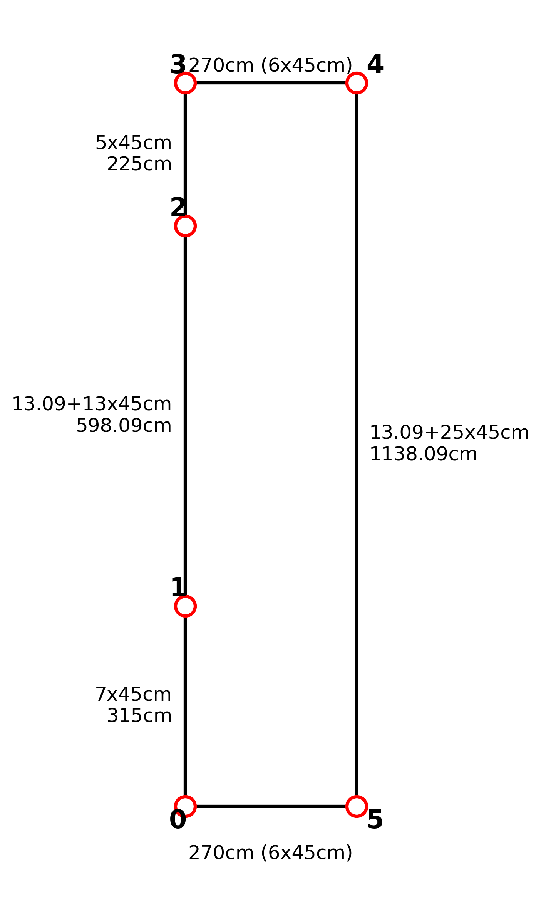

# MID-360s 与 C01：自采数据上的 SLAM 轨迹一致性评测

这个项目围绕一套**推车自采的室内 LiDAR + IMU 数据**，比较 GLIM、FAST-LIO2、LIO-SAM 和 Point-LIO 在两类固态雷达、两种场地与不同路线上的轨迹表现。

数据不是从公开 SLAM 数据集抽取的：2026 年 10 月 21 日用 **Livox MID-360s** 采集了 4 条录包，11 月 2 日换用 **SKYLANDX C01** 又采集了 4 条。每条数据都包含连续的点云和 IMU，采集时推车沿地面标记点移动，并在各点停车。后续在同一条录包上运行不同算法，导出轨迹，再比较窗口波动、闭合与轨迹一致性。

本仓库是整理后的轨迹、评测与说明入口。旧工作区 `slam_benchmark` 已弃用，不随本仓库上传；下文提到的旧目录仅用于记录历史数据来源。原始录包作为外部数据单独保存。**采集数据、运行算法、重新计算指标是三个不同环节**，日期和版本也分别记录。

- **规模**：8 条录包，约 27.5 分钟，16,518 帧点云、330,156 条 IMU 消息。
- **比较对象**：4 种算法，GLIM 的 map / odom 分开呈现，主清单共 38 份轨迹文件。
- **当前主评测**：固定原始 IMU 阈值，不读取图纸坐标或段长；没有独立参考轨迹，不报告 ATE/RPE。
- **阅读重点**：数据怎样采集、算法怎样接入、数字怎样计算，以及两颗雷达在这些数据上的差异。

| 内容 | 阅读目的 |
|---|---|
| [数据集来源与采集协议](docs/数据集说明.md) | 采集平台、现场照片、场地布局、8 条序列、ROS 消息和轨迹来源 |
| [指标说明](docs/指标说明.md) | RMS、VGICP、低动态散布、闭合和二维/三维分歧的定义 |
| [算法数据对比](docs/数据对比.md) | 汇总、逐序列结果、有效样本数、异常和阈值敏感性 |
| [两个雷达对比](docs/雷达对比.md) | 分组结果、同场地路线比较，以及配置与场景的影响 |

网站仍在完善，项目说明可阅读 README 与 `docs/*.md`，也可访问 <https://jimaoo0222.github.io/slam_benchmark_v02/>。GitHub Pages 的发布入口为 `docs/index.html`，网页、样式、图片和页面数据应随仓库提交；`site/` 仅作为本地预览副本忽略。

## 1. 为什么做这个项目

本项目从固态雷达的实际接入出发：在同一批自采录包上跑通四种算法，并判断它们的输出是否平稳、走回起点后是否接近、换场地或传感器后是否出现异常。

早期实验用卷尺、地砖和地面标记点建立场地参考，比较停车点位置与分段长度。这有助于发现路线错配、尺度变化与局部形变，但它不是全站仪或动捕提供的连续高精度参考轨迹；当结果进入厘米以下时，不能只凭这些点给算法排绝对精度名次。

因此，整理后的评测重点放在**轨迹自身的一致性**：在相同输入和相同窗口下，输出波动多大、返回位置差多少、不同系统估计的同一时刻位置是否接近。场地尺寸仍用于说明实验环境，但不进入当前主评测的计算或窗口筛选。

## 2. 数据集是怎样采集的

### 2.1 平台：推车、笔记本、电池和一颗雷达

采集平台为装有万向轮的小车，板面上放置运行 ROS 2 驱动和录包程序的笔记本，以 12 V 电池供电，雷达固定在板边。两颗雷达分别采集，不是双雷达同步录制，也不是把两类数据融合成一条轨迹。



*采集平台实拍。照片展示安装方式，不表示所有录包的姿态与运动完全相同。*

采集流程为：**开始录包 → 推车沿标记路线移动 → 到地面标记点停车 → 继续移动 → 返回附近后结束录包**。原始记录的操作目标是在各点停约 3–5 s；实际录包包含更长的等待、起步、转弯和停车，不能把整个数据集视为匀速运动或认为首尾各 10 s 一定完全静止。

### 2.2 场地：小场地与长直走廊

小场地的记录范围约为 **6.30 × 1.80 m**，使用编号 0–4 的同一组地面标记点，设计两种访问顺序：

- 路线 A：`0 → 1 → 2 → 3 → 4 → 0`。
- 路线 B：`0 → 2 → 3 → 4 → 1 → 0`。



C01 还在约 **2.70 × 11.38 m** 的矩形走廊采集，使用编号 0–5 的标记点，分别正向和反向行走。长直结构、横向短段与转弯组成了不同于小场地的几何约束。



*布局图和标注尺寸来自原项目场地记录，用于理解场景与路线；当前主评测不以这些尺寸作为真值输入。*

### 2.3 八条序列分别是什么

| 序列 | 雷达 | 采集日期 | 场地与路线 | 录包时长 s | 点云帧数 | IMU 消息数 | 起点停车 |
|---|---|---|---|---:|---:|---:|---|
| `01_1` | MID-360s | 2026-10-21 | 小场地，路线 A，第 1 次 | 212.09 | 2,121 | 42,416 | 有 |
| `01_2` | MID-360s | 2026-10-21 | 小场地，路线 A，第 2 次 | 251.36 | 2,513 | 50,273 | 有 |
| `02_1` | MID-360s | 2026-10-21 | 小场地，路线 B，第 1 次 | 240.28 | 2,403 | 48,046 | 有 |
| `02_2` | MID-360s | 2026-10-21 | 小场地，路线 B，第 2 次 | 224.50 | 2,245 | 44,902 | 有 |
| `03_01` | C01 | 2026-11-02 | 走廊，正向 `0-1-2-3-4-5-0` | 193.86 | 1,938 | 38,715 | 有 |
| `03_02` | C01 | 2026-11-02 | 走廊，反向 `0-5-4-3-2-1-0` | 234.68 | 2,347 | 46,865 | 无 |
| `04_01` | C01 | 2026-11-02 | 小场地，路线 B | 158.61 | 1,586 | 31,678 | 有 |
| `04_02` | C01 | 2026-11-02 | 小场地，路线 A | 136.50 | 1,365 | 27,261 | 无 |

日期与时长取自 bag 的 `metadata.yaml`，日期按北京时间解释；路线与停车安排来自采集说明和场地配置。序列编号是本项目约定，`01/02` 对应 MID-360s，`03/04` 对应 C01。

这套数据的实验设计并不对称：**MID-360s 是两条路线各录两次；C01 是四种场地/方向组合各录一次**。所以 C01 的四条不能看成四次重复实验，也不能只按雷达各自四条的中位数判断硬件优劣。

`03_02` 与 `04_02` 行走路线仍朝起点返回，但录制开始时没有起点停车锚点；它们不能直接用于当前闭合评价。“采集时有起点停车”与“公共评测区间首秒通过低动态检查”也不同，例如 `03_01` 仍未通过当前首秒检查。

## 3. 原始录包怎样变成算法轨迹

```text
固定安装雷达、推车采集
        ↓
原始 ROS 2 bag：/livox/lidar + /livox/imu
        ↓ 同一条 bag 分别作为四个算法的输入
驱动消息适配 + 传感器外参配置 + 算法运行
        ↓
TUM 轨迹：时间戳、位置、四元数
        ↓ 清单登记、检查覆盖范围和异常
公共时间区间 + 原始 IMU 低动态窗口
        ↓
逐窗口 / 逐序列指标 → 算法对比 → 雷达分组对比
```

### 3.1 记录了什么消息

八条原始 bag 均为 ROS 2 SQLite3 存储，包含 `/livox/lidar`（`sensor_msgs/msg/PointCloud2`，约 10 Hz）和 `/livox/imu`（`sensor_msgs/msg/Imu`，约 200 Hz）。录制入口是原项目的 `scripts/26_record_bag.sh`，默认录这两个话题，并在录完后检查计数与频率。

点云保留 `x/y/z`、`intensity`、`tag`、`line` 和每点 `timestamp`，可以用于帧内运动畸变校正。部分算法需要 Livox `CustomMsg`，运行脚本通过转换节点适配。**原始 bag 与算法输入适配后的话题是两层数据**，不是每个算法重新录一份真实运动。

### 3.2 四个算法与五类输出

| 系统 / 输出 | 本项目采用的方式 | 阅读时的区别 |
|---|---|---|
| GLIM(map) | 离线运行后导出全局优化轨迹 | 包含全局建图修正 |
| GLIM(odom) | 在线录制 `/glim_ros/lidar_odom_corrected` | 不是离线 dump 的原始 `odom_lidar.txt`，也不保证与 map 来自同次运行 |
| FAST-LIO2 | ROS 2 里程计导出 | 使用点级时间戳适配，主归档没有额外 LC 版本 |
| LIO-SAM | ROS 2 移植版 mapping odometry | 使用 Livox 消息适配，输出可能出现全局修正 |
| Point-LIO | ROS 2 移植版逐点里程计 | 主归档没有额外 LC 版本；需保留发散记录 |

轨迹格式统一为 `timestamp x y z qx qy qz qw` 八列，位置单位为 m，时间戳以秒表示。主清单共有 `8 × 4 + 6 = 38` 份轨迹：32 份四算法基本输出，加 6 份 GLIM odom；不是 38 次同配置重复实验。

### 3.3 哪些配置与运行条件会影响比较

两颗雷达分别使用自身的 IMU–LiDAR 外参。原始记录中 MID-360s 的 IMU 在雷达系下位置为 `(11.00, 23.29, -44.12) mm`，C01 的厂商参考值为 `(18.90, 24.64, -53.50) mm`；不同算法配置的变换方向不同，不能直接照抄符号。

| GLIM 项目 | MID-360s 主配置 | C01 主配置 |
|---|---|---|
| 配准 | CPU GICP + iVox | CPU VGICP + iVox |
| 预处理体素 / 目标点数 | 1.0 m / 10,000 | 0.3 m / 18,000 |
| 协方差邻域 k | 10 | 15 |
| 里程计体素 | iVox 1.0 m | iVox 1.0 m，VGICP 0.5 m 单层 |
| 零速度更新 | 主配置未启用 | 启用 ZUPT，角速度阈值 0.08 rad/s |

原项目批跑脚本对 MID-360s 的 FAST-LIO2、LIO-SAM、Point-LIO 默认采用 1.0 倍回放；C01 的 LIO-SAM 为 0.7 倍、Point-LIO 为 0.35 倍，FAST-LIO2 通常 1.0 倍、`03_02` 有 0.7 倍覆盖配置。GLIM map 直接离线读 bag。这些是归档的运行协议，不是本次重新测出的吞吐率，也不能保证所有历史轮次完全相同。

不同倍率不改变传感器消息的原始时间戳，但会影响算法处理和丢帧情况，因此运行后仍需检查轨迹覆盖率。原项目还专门处理过 ROS 域串流、外参符号和 PointCloud2 点级时间戳的问题；详见[数据集说明](docs/数据集说明.md)中的来源与实验演进。

## 4. 现在怎样评价

当前入口是 `scripts/evaluate_no_truth.py`。它读取主清单、原始 IMU 和 TUM 轨迹，不读取场地坐标或图纸段长，不重新运行四个算法。

1. **提取低动态窗口**：对 IMU 模长作 0.1 s 平滑，主阈值为角速度 < 0.06 rad/s、加速度模长相对重力偏差 < 4%，连续至少 3 s，两端各裁去 0.5 s。IMU 低动态不能排除缓慢匀速平移，因此不把它直接称为已知静止真值。
2. **统一时间区间**：每条录包取已登记输出的共同覆盖时段，同一条数据内各算法使用相同候选窗口。
3. **分项计算**：窗口位置散布与航向标准差、合格返回序列的闭合距离，以及三维刚体对齐后的同一时刻轨迹分歧。
4. **报告样本与异常**：每项指标单列有效序列数；发散、缺轨迹、局部跳变和闭合不适用不混成一个“零误差”。

| 指标 | 回答的问题 | 单位 / 口径 |
|---|---|---|
| 水平 / 三维散布 | 窗口内的位置输出围绕自身均值波动多大 | XY / XYZ 的 RMS，mm |
| 航向散布 | 窗口内 yaw 输出波动多大 | 标准差，° |
| 闭合距离 | 确认返回同一点后，首末位置是否接近 | 共同区间首末各 1 s 的三维均值距离，mm |
| 轨迹间分歧 | 不同算法在同一时刻的估计是否一致 | 每 0.1 s 插值，三维刚体对齐，不调整尺度，mm |
| 连续性与失稳 | 是否发生单帧跳变、异常速度或大范围发散 | 逐序列异常明细 |

**RMS 为 2 mm 表示相对窗口均值的波动，不表示距离真实位置只有 2 mm。** 闭合小也不能证明运动中没有形变。完整公式、RMS / VGICP / ZUPT 解释和二维/三维差异见[指标说明](docs/指标说明.md)。

旧 `scripts/build.py` 使用图纸段长与参考轨迹辅助筛选停车窗口，还计算重访和段长偏差。该方法及其 `eval/`、`tables/` 结果保留用于历史复核，不能与当前固定 IMU 窗口的数字直接混合。无真值要求针对当前计算流程，不意味着删除数据集的原始场地记录。

## 5. 数据对比与两个雷达的比较

| 输出 | 当前水平散布 mm | 当前闭合 mm | 闭合有效序列 / 有效轨迹 |
|---|---:|---:|---|
| GLIM(map) | 2.1 | 8.4 | 5 / 8 |
| GLIM(odom) | 2.9 | 15.4 | 3 / 6 |
| FAST-LIO2 | 6.5 | 67.4 | 5 / 8 |
| LIO-SAM | 4.9 | 21.9 | 5 / 8 |
| Point-LIO | 5.5 | 6.5 | 5 / 7 |

来源为 `eval/no_truth/metrics_no_truth.json`：散布先取每条序列的窗口中位数，再取跨序列中位数；闭合仅汇总适用序列。这张表用于概览，不代表五组样本完全相同或存在统一的精度总排名。

### 5.1 同一录包内，先看算法差异

GLIM(map) 在所选低动态窗口中的水平输出更集中；Point-LIO 在有效返回序列上的闭合较小，但 `03_02` 发散，`04_01` 还需检查中段高度变化。LIO-SAM 的 `02_1` 存在约 1.40 m 单帧位置跳变。这些现象说明短期平稳、长期闭合和失稳风险需要分别阅读。

[算法数据对比](docs/数据对比.md)保留逐序列表、阈值敏感性、有效样本数和异常时间，不只给汇总名次。

### 5.2 跨雷达，先匹配场地和路线

MID-360s 四条都在小场地；C01 多了两条走廊序列，GLIM 也采用另一套配准与零速更新配置。因而整组中位数混合了传感器、环境、运动与参数变化。

更接近可比条件的是：路线 A 用 `01_1/01_2` 对 `04_02`，路线 B 用 `02_1/02_2` 对 `04_01`。即使如此，C01 每条路线只有一次采集，起点停车安排也不完全相同。当前 C01 只有 `04_01` 一条通过主闭合检查，不能与 MID-360s 的四条闭合中位数作硬件优劣排名。

[雷达对比](docs/雷达对比.md)分别列出完整分组和同路线结果。当前可以讨论这两套传感器与算法配置在已采数据上的表现，还不能把差异归因于某颗雷达的绝对精度。

## 6. 实验版本与数据来源

这套数据在采集之后经历了多轮接入和评测修正：2026-11-05 统一外参；C01 的 GLIM 后续改用 VGICP；2026-11-07 的实验强化 IMU 窗口和 ROS 域隔离；主清单最终把 C01 GLIM 换成 `2026-11-09_SENIOR_V2_C01` 目录中的适配版 CPU 输出。目录中的日期是实验批次标签，不等于原始录包的采集时间。

本次重新核对了全部 38 份主轨迹与原项目归档：37 份找到字节完全一致的来源；`02_2_fastlio` 没有找到完全一致的归档副本，主清单仍以本目录文件为准，明确保留这一来源缺口。完整文件哈希、可匹配归档与元数据摘要见 [数据来源核对记录](config/dataset_provenance.json)。

详细记录、原始消息格式、采集命令和历史版本说明集中在[数据集说明](docs/数据集说明.md)。网页和 Markdown 都应以主清单、实际配置与本批结果为准，不能用某个旧实验的结论替代当前数据。

## 7. 使用与复现

先阅读现有结果不需要 ROS；重新计算指标需要原始 bag 与 ROS 2 环境：

```bash
cd /path/to/benchmark
source /opt/ros/humble/setup.bash
/usr/bin/python3 scripts/evaluate_no_truth.py --bag-root /path/to/raw_bags
/usr/bin/python3 scripts/update_explanations.py --no-html
```

第一步只重新评测已有轨迹，第二步只更新 Markdown 对比说明。需要系统 Python 的 NumPy、ROS 2 Humble 的 `rclpy` / `sensor_msgs`。`--bag-root` 指向包含 `01_1/`、`01_2/` 等八个序列子目录的外部数据目录；不传时默认读取仓库内的 `data/rosbag/`。这些原始数据不会随仓库提交。

直接阅读已有结果不需要原始 bag 或旧工作区。本仓库当前包含评测入口，不包含四算法完整运行环境；历史接入方式见[数据集说明](docs/数据集说明.md)。更新网站时使用 `scripts/update_explanations.py`（需要 `pandoc`），并提交 `docs/` 中的网页、样式及页面数据；GitHub Pages 使用 `main` 分支的 `/docs` 目录。

```text
benchmark/                         GitHub 仓库根目录（本地目前名为 new_benchmark）
├── README.md                       项目完整说明
├── docs/*.md                       数据集、指标、数据对比和雷达对比
├── docs/assets/img/                Markdown 使用的采集照片与布局图
├── config/manifest.json            本次使用的 38 份轨迹清单
├── config/dataset_provenance.json   历史来源核对与元数据摘要
├── traj/                           已整理 TUM 轨迹
├── eval/no_truth/                  当前无真值重算结果
├── eval/、tables/                  保留供复核的历史评测
├── scripts/                        当前与历史评测入口
├── data/rosbag/                    可选原始数据目录，不提交
├── docs/*.html、docs/assets/       GitHub Pages 发布内容，需提交
└── site/                           本地预览副本，不提交
```
