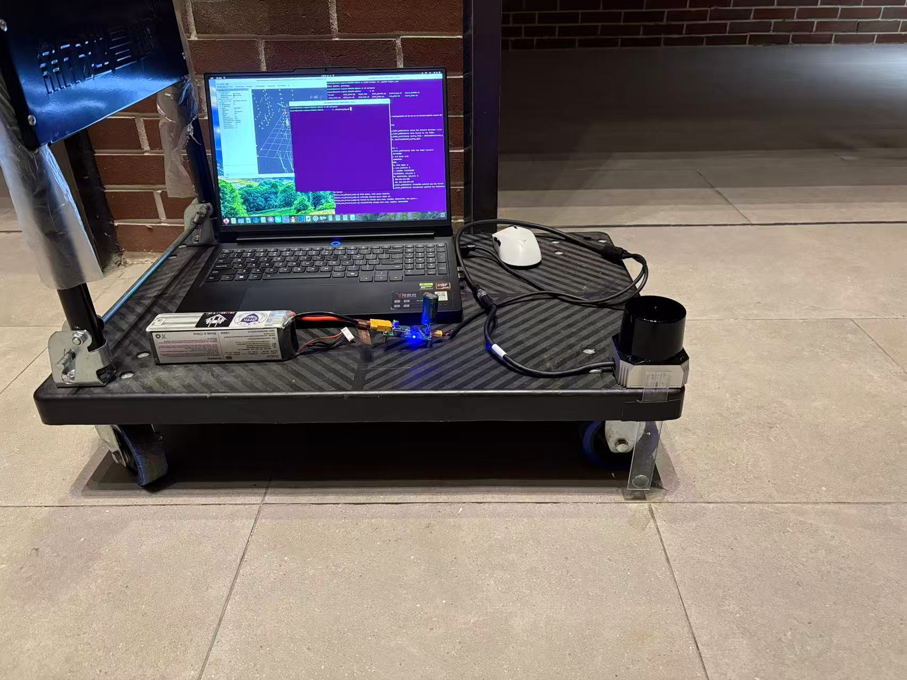
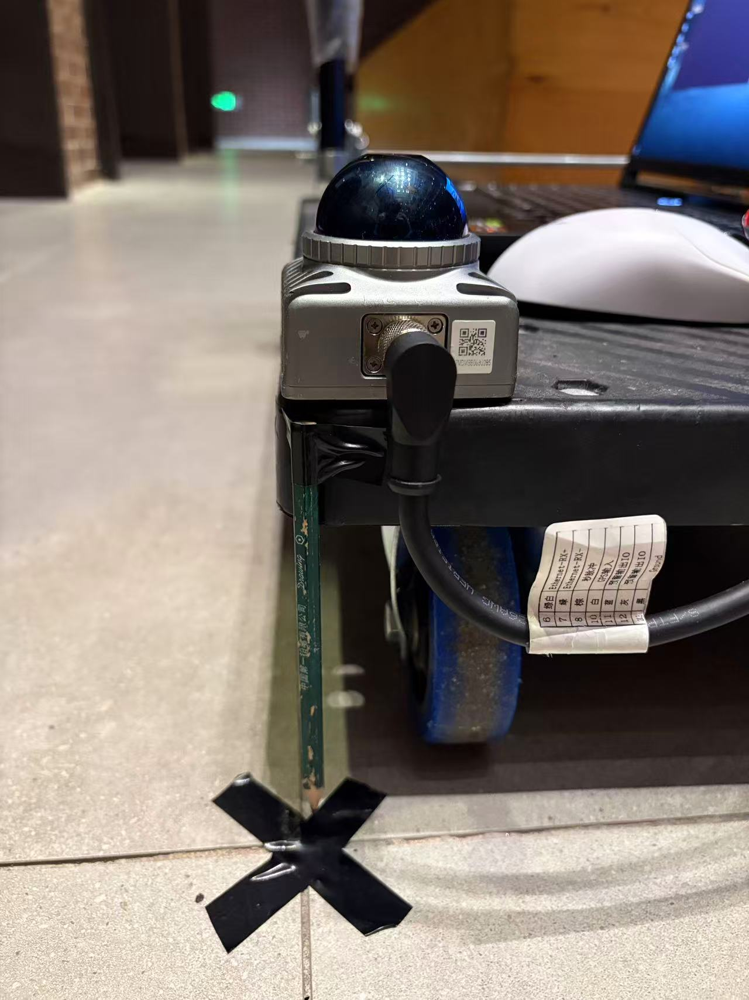
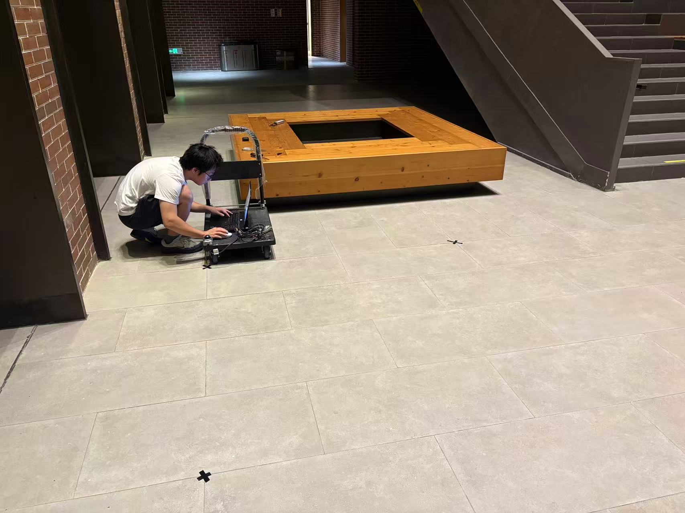
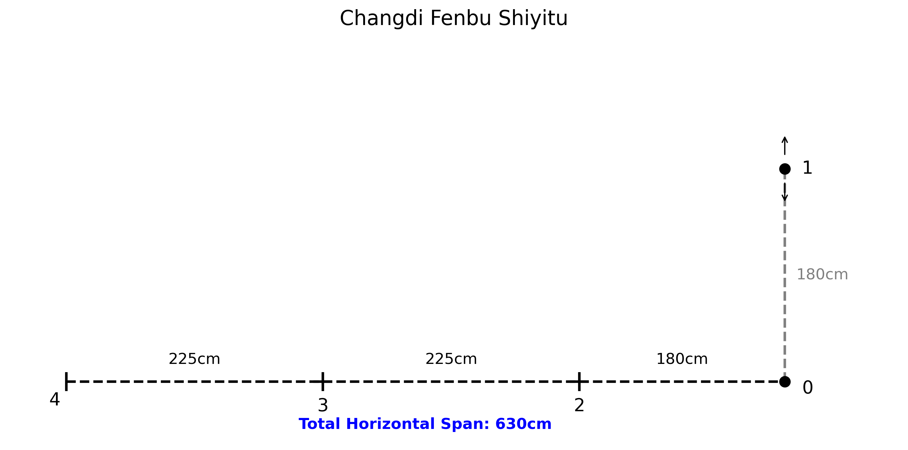
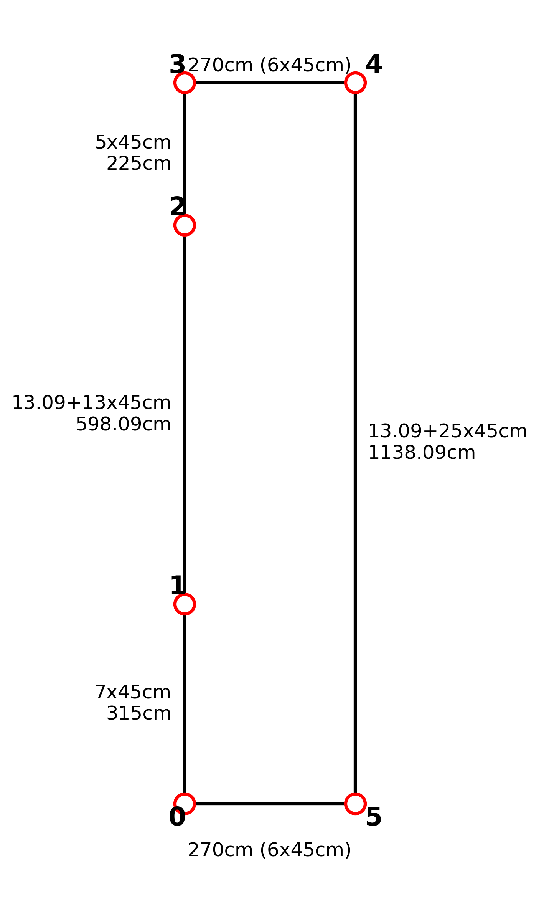

# 数据集来源与采集协议

[返回项目说明](../README.md) · [指标说明](指标说明.md) · [数据对比](数据对比.md) · [雷达对比](雷达对比.md)

## 1. 这套数据从哪里来

这是项目自行搭建推车平台、在室内标记路线后录制的点云与 IMU 数据，不是公开数据集的子集，也不是仿真轨迹。历史采集文件曾保存在旧工作区的 `slam_benchmark/rosbag/`。旧工作区已弃用且不上传；本仓库保存整理后的轨迹、清单与评测产物。重算时通过 `--bag-root` 指定外部原始数据目录，或放入本地 `data/rosbag/`。

原始 bag 元数据给出的采集时间分为两天：

- **2026-10-21，MID-360s**：`01_1`、`01_2`、`02_1`、`02_2`，小场地的两条路线各采两次。
- **2026-11-02，C01**：`03_01`、`03_02`、`04_01`、`04_02`，走廊正反向及小场地两种路线，各采一次。

这些日期是采集时间；`results/2026-11-05_*`、`2026-11-07_*` 等是后续算法运行的实验批次。一个 bag 可以在许多批次中重复使用，不能把每次重跑都算成一次新的现场采集。

原项目曾在[数据集页面](https://jimaoo0222.github.io/slam_benchmark/dataset.html)提供下载入口与校验说明。本次核对以本机原始 bag 为准，未重新验证外部下载链接的可用性；读取本目录的 TUM 轨迹无需下载整套 bag。

## 2. 采集平台与现场操作



平台为板面推车，四个万向轮支撑；笔记本运行雷达驱动与 ROS 2 录包，以 12 V 电池供电，雷达固定在板边。采集时推车移动，雷达随车一起运动。这个安装方式与手持直接晃动不同，但也不等于停车时完全没有真实振动。



地面用黑色 X 胶带标记停车点。原记录的操作安排是到点后停约 3–5 s，再走向下一点；实际等待可能更长，起步与停车过渡也保留在录包中。两颗雷达采用相同类型的采集流程，但在不同日期独立录制，没有同步双雷达的逐帧物理对应关系。



现场照片用于解释安装和路线组织方式，不能代替运动真值。记录中没有独立的全站仪、动捕或激光跟踪仪连续轨迹。

## 3. 场地、标记点与路线

### 3.1 小场地：同一组点，两种访问顺序

小场地的图纸记录范围约 6.30 × 1.80 m，编号点 0–4；原项目将其描述为室内货架仓库区域。下图显示标记点布局。



| 路线 | 访问顺序 | 对应数据 |
|---|---|---|
| A | 0-1-2-3-4-0 | MID-360s：01_1、01_2；C01：04_02 |
| B | 0-2-3-4-1-0 | MID-360s：02_1、02_2；C01：04_01 |

两条路线访问相同的物理点，但转弯、长短段与访问顺序不同。MID-360s 的每条路线各采两遍，C01 的每条路线只有一遍。C01 的 `04_02` 在录包起点没有停车，仅保留之后的停车锚点。

### 3.2 走廊：正向与反向

C01 另在约 2.70 × 11.38 m 的矩形走廊采集。标记点 0–5 沿两侧排列，路线包含长直段、短横移和转弯。



- `03_01`：`0-1-2-3-4-5-0`，正向，记录包含起点停车和返回。
- `03_02`：按原项目恢复的路线为 `0-5-4-3-2-1-0`，反向，出发时未在点 0 停车。其路线解释来自采集说明结合停车点顺序的历史复核，不是新增的独立测量。

场地尺寸来自卷尺及地砖推算，用于理解路线或复核历史段长评测。**当前主评测不读取这些尺寸或坐标。** 历史表中的约 15.15 m、14.65 m 是图纸路线折线长度；`03_02` 的 25.46 m、`04_02` 的 13.35 m 对应缺少首段起点锚点后的有停车记录部分，不应当作雷达真实累计行程。算法输出的逐帧路径长又是另一种量，会累加抖动与漂移。

## 4. 原始录包清单

以下时间取自各 `metadata.yaml` 的 `starting_time`，转换为北京时间；时长为 bag 记录时长，不是某算法导出轨迹的时长。

| 序列 | 开始时间（北京时间） | 时长 s | 点云消息 | IMU 消息 |
|---|---|---:|---:|---:|
| 01_1 | 2026-10-21 17:44:57 | 212.09 | 2,121 | 42,416 |
| 01_2 | 2026-10-21 18:00:10 | 251.36 | 2,513 | 50,273 |
| 02_1 | 2026-10-21 17:49:11 | 240.28 | 2,403 | 48,046 |
| 02_2 | 2026-10-21 18:04:27 | 224.50 | 2,245 | 44,902 |
| 03_01 | 2026-11-02 19:13:37 | 193.86 | 1,938 | 38,715 |
| 03_02 | 2026-11-02 19:18:41 | 234.68 | 2,347 | 46,865 |
| 04_01 | 2026-11-02 19:28:41 | 158.61 | 1,586 | 31,678 |
| 04_02 | 2026-11-02 19:31:40 | 136.50 | 1,365 | 27,261 |

总计约 27.5 分钟，16,518 帧点云、330,156 条 IMU 消息。采集时间排序不是文件名排序，例如 `02_1` 早于 `01_2`。

### 消息与文件格式

每个 bag 目录包含 `metadata.yaml` 和 SQLite3 `.db3` 文件。八条数据的原始话题一致：

| 话题 | ROS 消息类型 | 名义频率 | 用途 |
|---|---|---|---|
| `/livox/lidar` | `sensor_msgs/msg/PointCloud2` | 约 10 Hz | 激光点云，输入各算法 |
| `/livox/imu` | `sensor_msgs/msg/Imu` | 约 200 Hz | 角速度与加速度，输入算法并提取评测窗口 |

本次抽查 `01_1` 和 `03_01` 的首帧：分别为 20,064 和 21,696 点，`frame_id` 均为 `livox_frame`，每点占 26 字节，字段为 `x/y/z`（FLOAT32）、`intensity`（FLOAT32）、`tag/line`（UINT8）和 `timestamp`（FLOAT64）。这两帧用于确认数据布局，不能冒充全数据集每帧点数统计。原项目的转换脚本还处理每点时间单位识别与微小回退。

只有共同的话题名不意味着外参、点云特性和参数相同。两颗雷达的配置应分别选择。

## 5. 怎样录制与导出轨迹

以下是旧工作区的历史接入入口，用于说明轨迹如何产生；这些文件不随新仓库上传，也不是当前评测的目录依赖：

| 文件（相对 `../slam_benchmark/`） | 负责的环节 |
|---|---|
| `scripts/26_record_bag.sh` | 录制默认点云和 IMU 话题，录前检查话题，录后检查计数与频率 |
| `scripts/lib_radar.sh` | 按包名前缀选择雷达配置；不是运行时从点云自动识别硬件 |
| `scripts/16_pc2_to_custom.py` | 按算法需要将 PointCloud2 转为 Livox CustomMsg |
| `scripts/05_run_fastlio_on_bag.sh` | 运行 FAST-LIO2 并记录轨迹 |
| `scripts/17_run_liosam_on_bag.sh` | 运行 LIO-SAM、输入消息适配与轨迹记录 |
| `scripts/23_run_pointlio_on_bag.sh` | 运行 Point-LIO、消息适配与轨迹记录 |
| `scripts/12_run_glim_on_bag.sh` | GLIM 离线读 bag，导出 map 轨迹及可用的原始 odom |
| `scripts/27_run_glim_odom_on_bag.sh` | 单独在线录制 corrected odom |
| `scripts/traj_recorder.py` | 将 Odometry 话题转换为 TUM 八列文本 |

在另行配置好的 ROS 2 采集环境中，可用标准命令录制新的数据：

```bash
source /opt/ros/humble/setup.bash
# 先启动当前雷达对应的驱动，确认两个话题存在
ros2 bag record -o /path/to/raw_bags/new_sequence /livox/lidar /livox/imu
```

这个录包命令不会自动给新序列确定传感器类型、场地、返回关系或实验标签；新增数据需要另外登记。四算法重跑要按输入格式与各自配置分别启动，不能只替换轨迹文件名。脚本仍有历史工作区路径约定，复制到另一台设备前应核对。

TUM 每行格式如下：

```text
timestamp x y z qx qy qz qw
```

位置单位为 m，四元数次序为 x/y/z/w。评测使用消息或导出轨迹中的传感器时间，不能用启动进程的墙钟时间替换。算法初始化、发布频率与掉帧会让轨迹起点、长度和覆盖时长不同，因此需要共同区间和输出覆盖检查。

## 6. 数据接入与评测为什么有多个版本

| 实验记录 | 做了什么 | 对当前说明的意义 |
|---|---|---|
| `2026-11-05_外参修正` | 分雷达修正 IMU–LiDAR 外参、Point-LIO 平移符号、LIO-SAM 平移配置 | 不能把修正前后结果混成一次对照 |
| `2026-11-06_GLIM_VGICP_C01` 等 | C01 上改用 VGICP，另有 GPU 构建实验 | 算法名相同不代表配置相同 |
| `2026-11-07_IMUWIN_C01_d42` | IMU 候选窗口、段长辅助配对、ROS 域隔离 | 仍存在图纸辅助配对，不能把整条旧流程说成完全无真值 |
| `2026-11-08_内部一致性评测` | 整理多算法轨迹和 corrected odom | 是当前多数 MID-360s 轨迹的可匹配来源 |
| `2026-11-09_SENIOR_V2_C01` | C01 GLIM 换用适配版 CPU VGICP + ZUPT | 是当前清单 C01 GLIM 的来源批次；标签日期不等于采集日期 |
| `new_benchmark/eval/no_truth/` | 使用固定 IMU 阈值重新评测主清单轨迹 | 当前主说明与算法/雷达对比采用这套口径，不重跑算法 |

历史记录暴露过几个会直接改变实验含义的问题：点级时间戳没有正确用于去畸变、IMU–LiDAR 外参符号不一致、ROS 域中的其它节点混入消息，以及轨迹只覆盖部分录包。因此，不能仅凭某个实验目录中的一个 RMS 数字推断硬件精度。

其中 FAST-LIO2 的时间戳适配见 `patches/0001-fastlio-mid360-point-timestamp.patch`；LIO-SAM 与 Point-LIO 的 ROS 2 适配分别见 `patches/0002-*`、`0003-*`。本次文档整理没有重新编译、修改算法配置或重录数据。

## 7. 当前 38 份轨迹从哪些归档来

本次按文件内容 SHA-256 核对主清单与原项目 `results/` 下的轨迹：

| 当前文件组 | 找到内容一致的归档 |
|---|---|
| MID-360s 的多数基本轨迹和 `02_1/02_2` GLIM corrected odom | `2026-11-08_内部一致性评测/traj/` |
| `01_2_glim/traj.txt` | `2026-11-06_GLIMv2/01_2_glim/traj_glim.txt` |
| C01 的 FAST-LIO2 / LIO-SAM / Point-LIO | `2026-11-07_IMUWIN_C01_d42/{序列}_{算法}/traj.txt` |
| C01 的 GLIM map / corrected odom | `2026-11-09_SENIOR_V2_C01/{序列}_glim/` 与 `{序列}_glimodom/` |
| `02_2_fastlio/traj.txt` | 未找到字节完全一致的归档副本，保留当前主清单文件作为输入 |

37 份找到一致来源，1 份存在来源缺口。尤其 `02_2_fastlio` 的当前文件含 2,235 个位姿，而原项目同名 `2026-11-08` 归档文件只有 835 个位姿，不应因为名字相同就声明二者是同一文件。

详见[数据来源核对记录](../config/dataset_provenance.json)，其中记录每份主轨迹哈希、匹配路径和 bag 元数据摘要。元数据哈希只核验 `metadata.yaml`，不等于为整个 `.db3` 数据库做了校验。当前评测 JSON 的 `source_files` 另外记录实际使用轨迹的 SHA-256。

GLIM(odom) 的 `01_1` 在原记录中被标为时间跨度异常，主清单未纳入；`01_2` 也没有纳入主 odom 清单。本项目不为了补齐表格自动选择其它历史文件。map 与 corrected odom 的分别运行也不应自动理解为同次前后端配对。

## 8. 这套数据适合回答什么

同一条录包可以用于比较不同算法对同一输入的轨迹表现；小场地两种路线可以观察路线变化；C01 走廊序列可以暴露不同几何条件下的异常。同雷达同路线的两次现场采集提供有限的重复采集对照，但不同路线和不同采集动作不能混作严格的算法重复运行方差。

跨雷达的比较条件较弱：不同日期采集、场地构成不一致、每路线样本少、GLIM 配置不同。保留这些背景后，数据可以支持“哪组输出在本批数据上更平稳、哪条序列更容易失败”的讨论，不能直接支持硬件绝对精度排名。

## 9. 本说明的核对依据

- 原始 `rosbag/{序列}/metadata.yaml`：采集时刻、时长、消息类型与计数。
- 本项目 `config/manifest.json`：当前输入清单和 GLIM 输出类型。
- 原项目 `docs/01_MID360_vs_C01_雷达对比.md`、现场照片与 `config/site_*.json`：平台、地面标记、路线与场地背景。
- 原项目各轮 `results/*/README.md`、运行脚本、配置和补丁：版本演进与算法接入。
- 本次 SHA-256 内容核对：当前轨迹与归档文件的对应关系。

原记录中的“精度最好”“场地效应已确定”等结论没有直接继承；本说明区分可从文件确认的事实、历史实验解释与尚未控制的因素。
